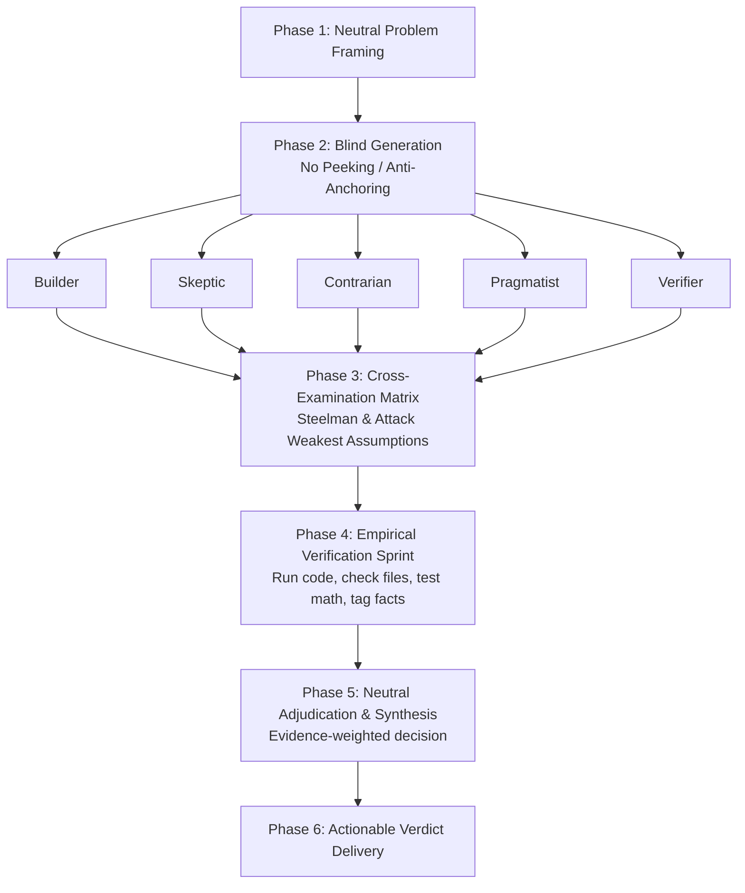

# Debate Reasoning Protocol (v2.0)

> **"One mind locks onto its first idea and defends it. Adversarial debate forces multiple independent positions, attacks weak assumptions, empirically tests what can be verified, and commits only when truth survives scrutiny."**

---

## 1. Why Debate Reasoning?

Large language models and single-threaded agents suffer from three major cognitive failure modes:
1. **First-Token Anchoring**: The agent latches onto the first plausible path generated in its context window and rationalizes it instead of exploring superior alternatives.
2. **Sycophancy & False Consensus**: When asked to self-reflect in a single context, models tend to agree with their previous outputs or cave to leading prompts.
3. **Hallucinated Verification**: Agents frequently claim an architecture or code solution "works" without executing code, checking constraints, or reading exact source files.

The **Debate Reasoning Protocol** solves this by establishing an adversarial, multi-perspective committee with a strict verification barrier and a neutral adjudicator.



---

## 2. Applicability Matrix

Do not use debate reasoning for every question. Reserve it for high-leverage decisions.

| Criteria | Use Debate Reasoning | Skip (Standard Execution) |
|---|---|---|
| **Impact / Reversibility** | Irreversible or expensive rollback (db schemas, core protocol, public APIs) | Easily reversible, one-line changes, routine tasks |
| **Ambiguity** | Multiple valid competing architectures, unclear trade-offs | Standard pattern with established best practice |
| **Root Cause Debugging** | Intermittent failures, multi-variable race conditions, distributed bugs | Deterministic crash with clear stack trace |
| **Verification Barrier** | Requires synthesizing conflicting logs, docs, and benchmarks | Direct command output immediately proves pass/fail |
| **Effort Scale** | **3 Roles** for medium decisions; **5 Roles** for high-stakes decisions | Single agent / immediate answer |

---

## 3. The 5 Debater Archetypes

Debaters are functional roles with distinct analytical mandates, not theatrical personalities.

```
+-------------------------------------------------------------------------+
|                                  ROLES                                  |
+------------------+------------------------------------------------------+
| 1. Builder       | Proposes the strongest affirmative path with clear   |
|                  | explicit prerequisites.                              |
+------------------+------------------------------------------------------+
| 2. Skeptic       | Attacks load-bearing assumptions, edge cases, and    |
|                  | failure modes under stress.                          |
+------------------+------------------------------------------------------+
| 3. Contrarian    | Inverts the problem premise; advocates an orthogonal |
|                  | or radical alternative.                              |
+------------------+------------------------------------------------------+
| 4. Pragmatist    | Evaluates operational reality, implementation cost,  |
|                  | tech debt, and rollback difficulty.                  |
+------------------+------------------------------------------------------+
| 5. Verifier      | Runs terminal checks, inspects code files, validates |
|                  | documentation, and audits empirical claims.          |
+------------------+------------------------------------------------------+
```

### Team Size Configurations:
- **Lightweight (3 Roles)**: Builder, Skeptic, Verifier. (Best for targeted code questions or localized design choices).
- **Full Spectrum (5 Roles)**: Builder, Skeptic, Contrarian, Pragmatist, Verifier. (Best for foundational architecture, major refactors, or high-ambiguity bugs).

---

## 4. The 6-Step Protocol

### Step 1: Neutral Problem Framing
The Lead Agent must write a neutral problem brief that does **not** bias toward any solution.

A proper frame must contain:
1. **Core Problem Statement**: 1-2 sentences strictly describing the goal or symptom.
2. **Hard Constraints**: Fixed performance budgets, non-negotiable tech stack bounds, deadlines, compliance or compatibility requirements.
3. **Evaluation Criteria**: What metric defines success (latency, throughput, simplicity, maintainability)?
4. **Context Corpus**: Exact file paths, documentation links, error logs, or environment specifics.

> **CRITICAL RULE**: Every debater receives the exact same neutral framing. Never inject personal preferences or hints into the frame.

---

### Step 2: Blind Generation (Anti-Anchoring Quarantine)
Each debater generates their position **in total isolation**, without reading peer responses.

Every role output must follow this mandatory schema:
```markdown
### Role: [Builder | Skeptic | Contrarian | Pragmatist | Verifier]
- **Core Proposal / Thesis**: [2-4 sentences detailing the stance]
- **Load-Bearing Assumptions**:
  1. [Assumption 1 - If this fails, the proposal collapses]
  2. [Assumption 2]
- **Failure Modes & Edge Cases**: [Where this breaks]
- **Empirical Claims Made**: [List of facts that can be checked in code/docs]
- **Confidence**: [Low | Medium | High]
- **Falsification Trigger**: "I would abandon this stance if [Specific Testable Condition]."
```

---

### Step 3: Cross-Examination Matrix
Once all positions are submitted, debaters review peer submissions. 

Cross-examination rules:
1. **Steelman First**: Before attacking an argument, state its strongest version. Strawmanning is strictly prohibited.
2. **Target Load-Bearing Assumptions**: Focus attacks on the single assumption that invalidates the proposal, not superficial style or wording.
3. **Mandatory Concession**: If a peer identifies a flaw or invalid assumption, the debater **must** explicitly concede and amend its position.
4. **Max Rounds**: Exactly 1 round of critique and 1 round of rebuttal/amendment (maximum 2 rounds total). Never allow open-ended circular debates.

Cross-examination output schema:
```markdown
### Cross-Examination by [Role]
- **Target Argument**: [Role being critiqued]
- **Vulnerability Identified**: [Why their key assumption fails]
- **My Concessions**: [What I admit was weak or wrong in my initial position]
- **Updated Position**: [My refined recommendation based on peer critique]
```

---

### Step 4: Empirical Verification Sprint
Debate alone cannot establish empirical ground truth. The **Verifier** takes charge of this step by actively testing disputed claims:

- Run diagnostic commands in the terminal (profilers, test suites, bench runs).
- Read precise code files, line numbers, and commit histories.
- Verify library documentation, APIs, and version constraints.
- Compute mathematical calculations and performance bounds.

All disputed claims are tagged with strict epistemic markers:
- `[VERIFIED: <evidence link / command output>]`
- `[REFUTED: <counter-evidence>]`
- `[UNVERIFIED: <reason why it cannot be tested right now>]`
- `[ESTIMATE: <bounds and calculation method>]`

> **THE VERIFIER VETO**: A verified fact immediately overrides an unverified theoretical argument, regardless of how elegantly phrased the argument was.

---

### Step 5: Neutral Adjudication & Synthesis
The Lead Agent acts as the impartial Judge. The Lead is **not** a debater.

#### Evaluation Rubric:
1. **Empirical Grounding (40%)**: Backed by verified facts, reproducible tests, and codebase evidence.
2. **Robustness Under Attack (25%)**: Survived cross-examination without foundational collapse.
3. **Constraint Compliance (20%)**: Respects all hard limits (latency, cost, complexity, timeline).
4. **Reversibility & Blast Radius (15%)**: What is the cost of being wrong? Is there a clean fallback path?

#### Dead-Heat Resolution:
If two positions remain equally viable after verification:
- Default to the option with lower operational complexity (Pragmatist bias).
- Or synthesize a **Third Alternative** combining the strength of both (e.g. an incremental migration or hybrid pattern).

---

### Step 6: Deliverable Verdict
Present a clean, high-signal verdict to the user. Do not dump the entire raw debate unless explicitly requested.

```markdown
## Final Verdict: [Decision Title]

### The Decision
[Direct, clear statement of what action to take]

### Key Load-Bearing Reasons
1. [Reason 1 - Supported by verified evidence]
2. [Reason 2 - Conceded by opposing roles]
3. [Reason 3 - Lowest operational blast radius]

### Rejected Alternatives & Why
- **[Alternative A]**: Rejected because [specific failure mode or refuted assumption].
- **[Alternative B]**: Rejected because [excessive complexity or unviable trade-off].

### Empirical Ground Truth
- `[VERIFIED]`: [Evidence 1]
- `[VERIFIED]`: [Evidence 2]
- `[UNVERIFIED RESIDUAL]`: [Remaining unknowns to monitor]

### Reversal Conditions (Kill-Switch)
"We will abort or reconsider this decision if [measurable metric or observation occurs]."
```

---

## 5. Execution Modes

### Mode A: Multi-Agent Parallel Execution (Sub-Agent Harness)
When running in an environment with sub-agent capabilities (such as Claude Code, Antigravity, or Cursor):
1. **Quarantine the Prompt**: Spawn separate sub-agent sessions for Builder, Skeptic, Contrarian, Pragmatist, and Verifier.
2. **Send Identical Context**: Pass only the neutral frame and the role mandate.
3. **Collect & Distribute**: Once all positions are returned, distribute the bundled positions to all agents for Cross-Examination.
4. **Trigger Verification**: Have the Verifier run real tools on contentious points.
5. **Judge**: Run the adjudication step in the lead coordinator context.

### Mode B: Single-Agent Sequential Mental Sandboxing
When running in a single-agent or single-prompt session:
1. Explicitly isolate each section using designated scratchpad blocks (`### Debater 1: Builder`, etc.).
2. Commit each role's answer completely before writing the next role's analysis.
3. Forbid retroactively modifying prior sections during the draft phase.
4. Execute cross-examination and verification sequentially before synthesizing the verdict.

---

## 6. Anti-Failure Rules

1. **Anti-Consensus Alarm**: If all 5 debaters agree on the first pass, halt immediately. Run a mandatory Devil's Advocate red-team pass: *"Assume this consensus solution fails catastrophically within 30 days. Explain exactly how and why."*
2. **Shared Model Blind-Spot Mitigation**: Agents powered by the same underlying LLM share training biases. Grounding through empirical tool use (file reading, test running, compiler checks) is mandatory.
3. **No Phantom Evidence**: Any role claiming "benchmarks show X" without citing an exact benchmark file or running a test is marked `[UNVERIFIED]`.
4. **Strict Round Cap**: Never exceed two rounds of cross-examination. Extended debates exhibit diminishing returns and converge on semantic bickering.
5. **Truth Over Winning**: Roles are evaluated by their contribution to finding the correct answer, including graceful concessions when proven wrong.
